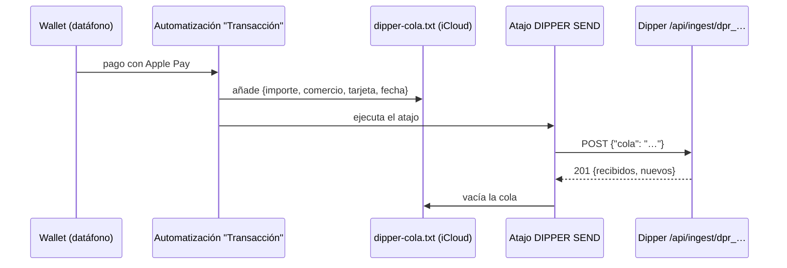
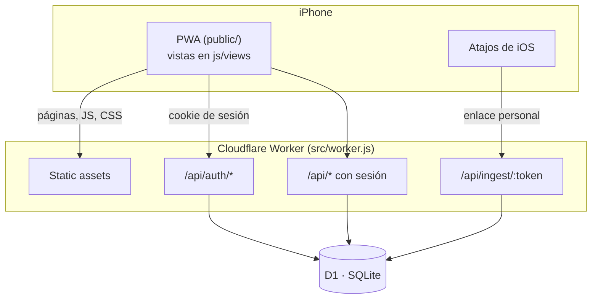
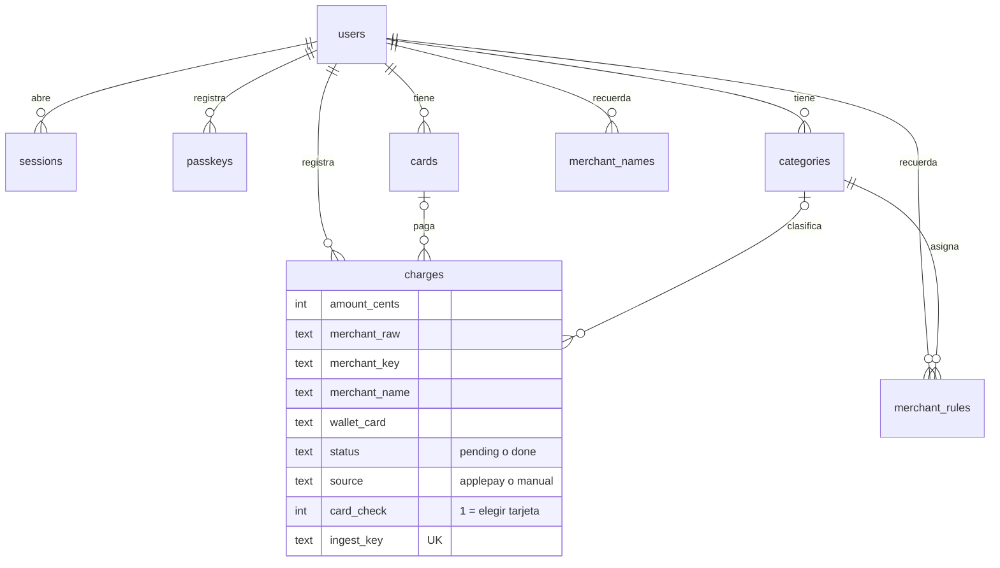

<div align="center">


# Dipper

**Tus gastos del mes, a la vista.**
App personal para iPhone que recoge sola los pagos de Apple Pay y los reparte por tarjetas, categorías y presupuesto.

[](https://developers.cloudflare.com/workers/)
[-F38020?logo=cloudflare&logoColor=white)](https://developers.cloudflare.com/d1/)
[](https://developers.cloudflare.com/workers/wrangler/)
[](https://simplewebauthn.dev)
[](https://developer.mozilla.org/docs/Web/JavaScript)

</div>

> Proyecto personal: una sola cuenta, pensada para el iPhone de su dueño y usada como app de pantalla de inicio (PWA).

## Contenido

- [Qué es](#qué-es)
- [Funcionalidades](#funcionalidades)
- [Cómo llegan los pagos](#cómo-llegan-los-pagos)
- [Stack](#stack)
- [Arquitectura](#arquitectura)
- [Modelo de datos](#modelo-de-datos)
- [API](#api)
- [Seguridad](#seguridad)
- [Puesta en marcha](#puesta-en-marcha)
- [Entornos y despliegue](#entornos-y-despliegue)
- [Scripts](#scripts)
- [Pruebas](#pruebas)
- [Estructura del repositorio](#estructura-del-repositorio)
- [Guía de diseño y especificación](#guía-de-diseño-y-especificación)
- [Decisiones de diseño](#decisiones-de-diseño)

## Qué es

Apuntar cada gasto a mano no dura más de una semana. Dipper parte de que casi todo se paga ya con
Apple Pay: una automatización de **Atajos** de iOS envía cada pago a Dipper en el momento de acercar
el móvil al datáfono, y la app solo pregunta lo que no puede saber sola (la categoría de un comercio
nuevo, o con cuál de dos tarjetas iguales se pagó).

A partir de ahí, el Inicio enseña lo gastado en el mes, lo que queda del presupuesto, el gasto por
tarjeta y por categoría.

> Lo que se repite se aprende una vez: un comercio confirmado con su categoría (y su nombre propio)
> se coloca solo la próxima vez.

## Funcionalidades

| Área | Qué ofrece |
|---|---|
| **Inicio** | Total del mes, aire que queda del presupuesto en 20 segmentos, tarjetas en abanico (la de más gasto delante; al tocarlas se despliegan) y un recuadro por categoría con su gasto. Navegación entre meses. |
| **Pagos de Apple Pay** | Llegan solos por el atajo, incluso los que se hicieron sin conexión (cola en el iPhone). Los repetidos se descartan. |
| **Por revisar** | Pagos de comercios nuevos: se elige categoría (con sugerencia por el nombre), se puede poner un nombre propio al comercio y unir nombres distintos de Apple Pay con las fichas de "Tus comercios". "Recordar este comercio" coloca solos los siguientes. |
| **Tarjetas iguales** | Si el nombre que manda Wallet coincide con varias tarjetas guardadas, el pago siempre pasa por Por revisar para elegir con cuál se pagó (viene marcada la última usada en ese comercio). |
| **Pago** | Cambiar categoría, tarjeta o nombre del comercio (se aplica a todos sus pagos), o borrar el pago. |
| **Nuevo gasto** | Gastos a mano (efectivo, Bizum, recibos) con importe, categoría, tarjeta y fecha. |
| **Presupuesto** | Total mensual y reparto por categoría, válido para todos los meses. |
| **Tarjetas y categorías** | Crear, editar y borrar. En las listas de Ajustes, deslizar una fila a la izquierda muestra Editar y Borrar. Seis categorías de partida, todas editables. |
| **Acceso** | Correo y contraseña, Face ID (passkeys) y cambio de contraseña desde Ajustes. |

## Cómo llegan los pagos



1. La automatización de Atajos se dispara con cada pago y añade una línea JSON a una cola en iCloud.
2. Un atajo aparte (**DIPPER SEND**) envía la cola entera al enlace personal del usuario y la vacía.
   Va separado porque dentro de la automatización iOS corta las peticiones de red.
3. El servidor acepta un objeto suelto, varios seguidos o `{"cola": "…"}`, y descarta los repetidos
   con una huella de `fecha|importe|comercio|tarjeta`. Una cola vacía devuelve `200`, así que el envío
   se puede programar también cada noche.
4. Cada pago se asocia a una tarjeta por su nombre en Wallet (o por los 4 últimos dígitos si vienen en
   el nombre) y, si el comercio está recordado, entra ya con su categoría y su nombre.

La pantalla **Ajustes › Conectar Apple Pay** muestra el enlace personal y los pasos para montar el atajo.

## Stack

| Capa | Tecnología |
|---|---|
| Servidor | [Cloudflare Workers](https://developers.cloudflare.com/workers/) (`src/worker.js`), sin framework |
| Base de datos | [Cloudflare D1](https://developers.cloudflare.com/d1/) (SQLite) con migraciones SQL |
| Cliente | PWA en JavaScript sin framework ni paso de compilación (`public/`), servida como *static assets* del Worker |
| Face ID | [SimpleWebAuthn](https://simplewebauthn.dev) 13 en el servidor y WebAuthn del navegador |
| Herramientas | [Wrangler](https://developers.cloudflare.com/workers/wrangler/) 4 para desarrollo, migraciones y despliegue |
| Tipografía | Bricolage Grotesque (Google Fonts) |

## Arquitectura



- Todo lo que no empieza por `/api/` lo sirven los *static assets*; el Worker solo atiende la API.
- `/api/ingest/` se identifica con el enlace personal (`dpr_…`), no con la sesión, porque lo llama Atajos.
- El resto de `/api/*` exige la cookie de sesión y, en los `POST`, cuerpo `application/json`.
- El cliente es una SPA con rutas por *hash* (`#/por-revisar`, `#/pago?id=…`) definidas en
  [`public/js/app.js`](public/js/app.js).

## Modelo de datos

| Tabla | Propósito |
|---|---|
| `users` | La cuenta, su contraseña (PBKDF2), el enlace de ingesta y el presupuesto mensual |
| `sessions` | Sesiones abiertas (solo el hash del token) y si se entró con contraseña o Face ID |
| `passkeys` | Claves de Face ID registradas |
| `challenges` | Retos de WebAuthn de un solo uso (5 minutos) |
| `login_failures` | Intentos fallidos para frenar la fuerza bruta |
| `cards` | Tarjetas: nombre, 4 dígitos, nombre en Wallet y color |
| `categories` | Categorías con icono, color, presupuesto y orden |
| `charges` | Pagos: importe en céntimos, comercio original y normalizado, tarjeta, categoría, estado |
| `merchant_rules` | Categoría recordada por comercio |
| `merchant_names` | Nombre propio recordado por comercio |



Los importes se guardan en céntimos (positivo = gasto, negativo = devolución) y las fechas en
milisegundos; el mes se calcula en hora de Madrid. Las migraciones están en [`migrations/`](migrations).

## API

Todas las rutas devuelven JSON. Salvo `/api/ingest/` y `/api/auth/` (login, registro y Face ID),
exigen sesión.

| Método | Ruta | Descripción |
|---|---|---|
| `POST` | `/api/ingest/:token` | Recibe pagos del atajo (objeto, lista, varios seguidos o `{cola}`) |
| `POST` | `/api/auth/register` · `/login` · `/logout` | Crear la cuenta (solo la primera), entrar y salir |
| `POST` | `/api/auth/passkey/login/options` · `/verify` | Entrar con Face ID |
| `POST` | `/api/auth/passkey/register/options` · `/verify` | Activar Face ID |
| `GET` | `/api/auth/me` | Usuario actual y cómo entró |
| `POST` | `/api/auth/password` | Cambiar la contraseña |
| `POST` | `/api/auth/delete-account` | Borrar la cuenta y todos sus datos (pide la contraseña salvo si se entró con Face ID) |
| `GET` | `/api/applepay` | Enlace personal para el atajo |
| `POST` | `/api/pagos` | Recibe pagos con la sesión del usuario, en los mismos formatos que `/api/ingest/` (para la acción de Atajos de la app nativa) |
| `GET` | `/api/pending` · `/api/pending/count` | Pagos por revisar (con sugerencias y "Tus comercios") y su número |
| `POST` | `/api/pending/:id/confirm` · `/undo` | Confirmar categoría, nombre y tarjeta, o deshacerlo |
| `GET` | `/api/month?month=AAAA-MM` | Datos de un mes ya calculados: pagos, total, lo que queda, gasto por tarjeta y por categoría y lo que toca al día. `&tarjeta=` o `&categoria=` filtran la lista de pagos |
| `GET` · `POST` | `/api/charges/:id` | Ver un pago o cambiar su categoría, tarjeta, importe, concepto (nota propia), fecha (hasta un año por delante) o nombre de comercio |
| `GET` | `/api/history` | Los últimos 150 pagos por orden de registro (`createdAt`), con tarjetas y categorías |
| `POST` | `/api/charges` · `/api/charges/:id/delete` | Añadir un gasto a mano o borrar un pago |
| `GET` · `POST` | `/api/cards` · `/api/cards/:id` · `/delete` | Listar, crear, editar y borrar tarjetas |
| `GET` · `POST` | `/api/categories` · `/api/categories/:id` · `/delete` | Listar, crear, editar y borrar categorías |
| `POST` | `/api/categories/order` | Guardar el orden de las categorías (todos sus ids, en orden) |
| `POST` | `/api/budget` | Guardar el presupuesto total y por categoría |

## Seguridad

- **Contraseñas con PBKDF2-SHA256** (100.000 iteraciones, el máximo de Workers) y sal aleatoria;
  la comparación es de tiempo constante.
- **Sin enumeración de cuentas**: con un correo inexistente se calcula igualmente un hash y el error es el mismo.
- **Freno a la fuerza bruta**: 5 intentos fallidos por correo bloquean 15 minutos.
- **Sesiones**: token aleatorio en cookie `HttpOnly`, `SameSite=Lax` y `Secure` en HTTPS, o en la
  cabecera `Authorization: Bearer` para la app nativa (que lo pide con `X-Dipper-Client: app`; la web no
  lo recibe nunca). En la base de datos solo se guarda su SHA-256. Duran 30 días y cambiar la
  contraseña cierra las demás.
- **Registro controlado**: con `REGISTRO_ABIERTO = "no"` solo se puede crear la primera cuenta; con
  `"si"`, cualquiera, sin repetir correo.
- **Borrar la cuenta** elimina, tabla a tabla, todo lo del usuario.
- **Face ID con WebAuthn**: retos de un solo uso que caducan a los 5 minutos y verificación de usuario obligatoria.
- **Aislamiento por usuario**: cada consulta filtra por `user_id`, también al mover pagos entre tarjetas o categorías.
- **Enlace de ingesta secreto** (`dpr_` + 18 bytes aleatorios); sin él no se puede enviar ningún pago.

## Puesta en marcha

Requisitos: Node.js 22 o superior (lo pide Wrangler 4) y una cuenta de Cloudflare (solo para desplegar).

```bash
# 1. Instalar dependencias
npm install

# 2. Crear las tablas en la base de datos local
npm run db:local

# 3. Arrancar en http://localhost:8787
npm run dev
```

💡 La primera vez, crea la cuenta desde la pantalla de inicio; después el registro queda cerrado.
Para probar la ingesta en local, copia el enlace de **Ajustes › Conectar Apple Pay** y envía un pago:

```bash
curl -X POST http://localhost:8787/api/ingest/dpr_TU_ENLACE -H "content-type: application/json" -d '{"importe":"12,50","comercio":"MERCADONA VALENCIA","tarjeta":"Mi Visa","fecha":"2026-10-15T12:00:00Z"}'
```

La configuración está en [`wrangler.toml`](wrangler.toml), sin secretos:

| Variable | Real | Pruebas | Qué hace |
|---|---|---|---|
| `REGISTRO_ABIERTO` | `no` | `si` | `si` deja crear cuentas a cualquiera; `no`, solo la primera (app personal) |

## Entornos y despliegue

| Entorno | Dirección | Base de datos | Publicar |
|---|---|---|---|
| Real | `dipper.dipper-app.workers.dev` | D1 `dipper` | `npm run db:remote` y `npm run deploy` |
| Pruebas | `dipper-pruebas.dipper-app.workers.dev` | D1 `dipper-pruebas` | `npm run db:pruebas` y `npm run deploy:pruebas` |

Flujo de trabajo:

1. Cada funcionalidad se hace en su propia rama (`feature/…`).
2. Se publica en **pruebas**, que tiene su propia base de datos y su propio usuario.
3. Con el visto bueno, se une a `main` y se publica en el entorno real.

⚠️ Si la rama trae migraciones nuevas, hay que aplicarlas (`npm run db:remote`) **antes** de
`npm run deploy`: el código nuevo cuenta con las columnas nuevas.

Los registros de cada petición (incluido un `ingest` por envío del atajo) se ven en Workers Logs.

## Scripts

| Comando | Acción |
|---|---|
| `npm run dev` | Servidor local con base de datos local |
| `npm run db:local` | Aplica las migraciones a la base de datos local |
| `npm run db:remote` | Aplica las migraciones a la base de datos real |
| `npm run db:pruebas` | Aplica las migraciones a la base de datos de pruebas |
| `npm run deploy` | Publica en el entorno real |
| `npm run deploy:pruebas` | Publica en el entorno de pruebas |
| `npm test` | Ejecuta las pruebas del servidor |
| `npm run reset-password` | Pone una contraseña nueva a la cuenta real desde el ordenador ⚠️ cierra todas las sesiones |
| `npm run icons` | Regenera los iconos PNG de la app |

## Pruebas

```bash
npm test
```

Las pruebas corren el Worker dentro del mismo runtime de Cloudflare (con
[`@cloudflare/vitest-plugin`](https://developers.cloudflare.com/workers/testing/vitest-integration/))
y una base D1 local que se crea con las migraciones y se vacía antes de cada prueba.

| Archivo | Pruebas | Qué comprueba |
|---|---|---|
| [`test/unidad.test.js`](test/unidad.test.js) | 18 | Lectura de importes en sus distintos formatos, colas de Atajos, normalización de comercios y las cifras del resumen del mes |
| [`test/api.test.js`](test/api.test.js) | 21 | La API de punta a punta: una sola cuenta, bloqueo tras 5 fallos, cola sin duplicados, recordar y deshacer, nombre propio, reconocimiento de tarjetas y tarjetas iguales, borrar tarjetas y categorías, gastos a mano, resumen y filtros del mes orden de las categorías y presupuesto |
| [`test/app-store.test.js`](test/app-store.test.js) | 12 | Lo que pide la app nativa y el App Store: sesión por token, registro abierto o cerrado, borrar la cuenta y recibir pagos con la sesión |

Cubren las reglas de [`docs/flujos.md`](docs/flujos.md) que viven en el servidor: si un cambio para la
app nativa rompe alguna, salta una prueba.

## Estructura del repositorio

```text
src/
  worker.js        # Entrada del Worker: assets, rutas de la API y sesión
  auth.js          # Registro, login, sesiones, cambio de contraseña y Face ID
  payments.js      # Ingesta desde Atajos y pantalla Por revisar
  merchants.js     # Normalización de comercios y categoría sugerida por el nombre
  charges.js       # Datos del mes, pago a pago y gastos a mano
  cards.js         # Tarjetas y su reconocimiento por nombre de Wallet
  categories.js    # Categorías y las seis de partida
  budget.js        # Presupuesto total y por categoría
  util.js          # JSON, cookies, hashes y tokens
public/
  index.html       # Página única de la PWA
  style.css        # Tokens y clases comunes (ver DISENO.md)
  js/app.js        # Rutas por hash y arranque
  js/components.js # Piezas compartidas: listas de movimientos, fichas, filas deslizables…
  js/dom.js        # Utilidades de DOM y juego único de iconos (ICON)
  js/views/        # Una vista por pantalla
migrations/        # Esquema de D1, una migración por cambio
scripts/           # Iconos y cambio de contraseña desde el ordenador
wrangler.toml      # Worker, bases D1 y entorno de pruebas
test/              # Pruebas del servidor (npm test)
vitest.config.mjs  # Configuración de las pruebas
DISENO.md          # Guía de diseño
docs/              # Especificación: componentes, pantallas, flujos y auditoría
```

## Guía de diseño y especificación

- [`DISENO.md`](DISENO.md): reglas visuales (colores, líneas, esquinas, botones, iconos y patrones
  como editar o borrar). Toda pantalla o pieza nueva reutiliza lo que ya existe allí.
- [`docs/`](docs/README.md): el plano de la app por piezas (componentes, pantallas y flujos con sus
  reglas) y una auditoría de lo que queda por ordenar. Es la base para llevar Dipper a una app nativa
  en Swift sin tener que leer el JavaScript.

## Decisiones de diseño

- **PWA en lugar de app nativa.** Sin Mac no se puede compilar para iOS; una PWA instalada en la
  pantalla de inicio, sin zoom ni rebote y con animaciones, se comporta como una app.
- **Apple Pay a través de Atajos.** Es la única vía para enterarse de un pago al momento sin acceso
  al banco. Como Atajos no da los 4 últimos dígitos, las tarjetas se reconocen por su nombre en Wallet.
- **Cola en iCloud y envío en un atajo aparte.** Dentro de la automatización de pago iOS corta las
  peticiones de red; guardar primero y enviar después hace que no se pierda ningún pago, aunque no
  haya conexión.
- **Huella de cada pago.** Reenviar la cola es seguro: el servidor ignora lo que ya tenía.
- **Preguntar antes que adivinar.** Con dos tarjetas que se llaman igual, Dipper pregunta con cuál
  se pagó en lugar de elegir en silencio.
- **Recordar por comercio.** La categoría y el nombre propio se guardan por comercio normalizado
  (`MERCADONA VALENCIA` → `MERCADONA`): en las cadenas que Dipper reconoce, una tienda nueva ya entra
  colocada.
- **Una sola cuenta, de momento.** Hoy es una app personal: en el entorno real el registro se cierra
  tras la primera cuenta y no hay recuperación por correo, sino `npm run reset-password` desde el
  ordenador. El servidor ya admite varias cuentas (`REGISTRO_ABIERTO`) para cuando Dipper pase a ser
  una app nativa en el App Store.
- **Sin framework ni compilación.** Módulos ES servidos tal cual: se publica con un solo comando y
  no hay dependencias de cliente que mantener.
- **Entorno de pruebas aparte.** Las ramas se prueban con su propia base de datos, sin tocar los pagos reales.

---

<div align="center">Dipper · app personal de gastos</div>
