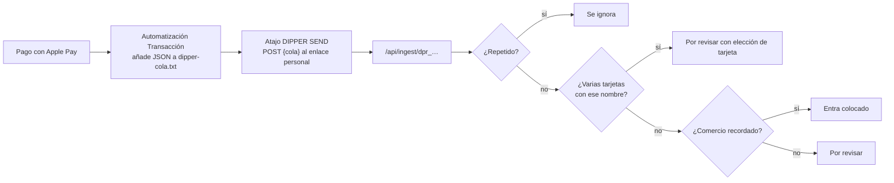

# Flujos y reglas

Lo que pasa en cada recorrido y las reglas que lo gobiernan. Casi todas viven en el **servidor**
(`src/`), así que la app en Swift las hereda sin reescribirlas; donde una regla vive hoy en la
pantalla, se indica con 📱 (ver [`auditoria.md`](auditoria.md)).

## Índice

- [Sesión y acceso](#sesión-y-acceso)
- [Llegada de pagos de Apple Pay](#llegada-de-pagos-de-apple-pay)
- [Comercios: nombre, clave y sugerencia](#comercios-nombre-clave-y-sugerencia)
- [Reconocer la tarjeta](#reconocer-la-tarjeta)
- [Por revisar](#por-revisar)
- [Editar un pago](#editar-un-pago)
- [Gasto a mano](#gasto-a-mano)
- [Tarjetas y categorías](#tarjetas-y-categorías)
- [Mes y presupuesto](#mes-y-presupuesto)

---

## Sesión y acceso

| Regla | Detalle | Dónde |
|---|---|---|
| Una sola cuenta | El registro solo funciona si no hay ninguna cuenta. Al crearla se añaden las 6 categorías de partida (Súper, Comida fuera, Transporte, Ocio, Ropa, Suscripciones) con su presupuesto. | `auth.js`, `categories.js` |
| Contraseña | Mínimo 8 caracteres. PBKDF2-SHA256, 100.000 iteraciones, sal de 16 bytes. | `auth.js` |
| Entrar | Correo en minúsculas. Error único "Correo o contraseña incorrectos." exista o no la cuenta. 5 fallos en 15 minutos bloquean ese correo 15 minutos. | `auth.js` |
| Sesión | Token aleatorio de 32 bytes en cookie de 30 días; en la base solo su SHA-256 y si se entró con contraseña o Face ID. | `auth.js` |
| Face ID | Passkey (WebAuthn) con verificación obligatoria; retos de un solo uso de 5 minutos. El iPhone recuerda que la tiene activada. | `auth.js`, `passkey.js` |
| Ofrecer Face ID | Tras entrar con contraseña, una sola vez, si el iPhone lo admite y no está activado. 📱 | `inicio.js` |
| Cambiar contraseña | Pide la actual salvo si se entró con Face ID. Cierra las demás sesiones. | `auth.js` |
| Olvido | No hay recuperación por correo: entrar con Face ID y cambiarla, o `npm run reset-password` desde el ordenador. | `scripts/reset-password.mjs` |

## Llegada de pagos de Apple Pay

**Hoy (PWA):**

| Regla | Detalle |
|---|---|
| Formato | Acepta un objeto, una lista, varios objetos seguidos o `{"cola": "…"}`. Campos sin distinguir mayúsculas: `importe`/`amount`/`cantidad`, `comercio`/`merchant`, `tarjeta`/`card`, `fecha`/`date`. Máximo 200 pagos por envío. |
| Importe | Admite "12,50 €", "€12.50", "1.234,56" o "1,234.56". Positivo = gasto, negativo = devolución; 0 o vacío se descarta. Se guarda en céntimos. |
| Fecha | ISO 8601. Sin fecha o con una más de un día en el futuro: ahora. |
| Repetidos | Con fecha, se calcula una huella `sha256(fecha\|importe\|comercio\|tarjeta)` y el mismo pago no entra dos veces. |
| Respuesta | `201 {recibidos, nuevos}`; cola vacía: `200` (sirve para un envío nocturno programado); sin importe: `400`. |
| Enlace | `dpr_` + 18 bytes aleatorios, creado la primera vez que se pide. Identifica la cuenta sin sesión. |

**En la app nativa (propuesta):** la app ofrece un **App Intent** "Registrar pago en Dipper" con
parámetros importe, comercio, tarjeta y fecha. La automatización *Transacción* lo llama
directamente, sin cola en iCloud ni atajo aparte, y la propia acción guarda el pago si no hay
conexión y lo envía después. iOS no deja crear la automatización desde la app: la pantalla Conectar
Apple Pay pasa a ser una guía de unos 6 toques con un botón que abre Atajos. Queda por comprobar si
iOS pasa los datos de la transacción a la acción solo o hay que asignarlos con un toque cada uno.

## Comercios: nombre, clave y sugerencia

| Regla | Detalle | Dónde |
|---|---|---|
| Original | Se guarda tal cual llega (`merchant_raw`), hasta 120 caracteres, y siempre se puede ver ("Apple Pay: …"). | `payments.js` |
| Clave | Se normaliza: sin acentos, mayúsculas, `&` → `AND`, todo lo que no es letra o número → espacio, y se quitan las palabras con cifras. Si coincide con una cadena conocida, la clave es la cadena: `MERCADONA VALENCIA` → `MERCADONA`. | `merchants.js` |
| Nombre | El propio que haya puesto el usuario para esa clave; si no, el de la cadena conocida ("Mercadona"); si no, la clave en formato título. | `merchants.js`, `payments.js` |
| Cadenas conocidas | Lista fija de supermercados, suscripciones, gasolineras y transporte, comida, ropa y cines, cada una con su categoría de partida. | `merchants.js` |
| Sugerencia de categoría | La recordada para el comercio; si no hay, la de partida de su cadena conocida. | `payments.js` |
| Nombre propio | Al confirmar con "Recordar" o al cambiarlo en Pago, se guarda para esa clave y se aplica a **todos** sus pagos, también a los que lleguen. Sin "Recordar", solo a ese pago. Hasta 60 caracteres. | `payments.js`, `charges.js` |
| Tus comercios | Los nombres de los pagos ya clasificados, del más usado al menos, con la categoría de su último pago (hasta 60). Tocar uno une el pago a ese nombre. | `payments.js` |

## Reconocer la tarjeta

| Regla | Detalle | Dónde |
|---|---|---|
| Por nombre de Wallet | Atajos solo manda el nombre de la tarjeta en Wallet, no los dígitos. Se busca una tarjeta guardada con ese mismo "Nombre en Wallet" (sin distinguir mayúsculas). | `payments.js` |
| Por dígitos | Si ninguna coincide por nombre, una tarjeta cuyos 4 dígitos aparezcan en el nombre recibido. | `payments.js` |
| Tarjetas iguales | Si coinciden **varias**, el pago se marca para elegir tarjeta (`card_check`), nunca entra colocado y se propone la tarjeta usada la última vez en ese comercio. | `payments.js` |
| Tarjeta guardada después | Al crear o editar una tarjeta, los pagos que llegaron sin tarjeta y encajan con ella se le asignan. Si con ella ya hay dos con el mismo nombre de Wallet, los pendientes de ese nombre pasan a pedir tarjeta. | `cards.js` |

## Por revisar

| Regla | Detalle |
|---|---|
| Qué entra | Pagos de Apple Pay de comercios sin categoría recordada, y todos los que piden tarjeta. |
| Confirmar | Exige categoría (y tarjeta si la pide). Con **Recordar**: se guarda la categoría para el comercio y los demás pendientes del mismo comercio se colocan solos (salvo los que piden tarjeta). |
| Deshacer | Devuelve a pendientes el pago y los que se colocaron con él; si se había recordado, se olvida la regla. El nombre propio no se deshace. |
| Tarjeta nueva | Si llega un nombre de Wallet que no tiene ninguna tarjeta, se ofrece guardarla con ese nombre y, si aparecen al final, los 4 dígitos. |
| Contador | El número de pendientes se ve en la barra y en el Inicio. |

## Editar un pago

- Se puede cambiar categoría, tarjeta (o Efectivo), nombre del comercio (afecta a todos sus pagos)
  o borrarlo (con confirmación). Elegir una categoría deja el pago como resuelto.

## Gasto a mano

| Regla | Detalle |
|---|---|
| Datos | Importe > 0 (hasta 1.000.000 €), categoría obligatoria, tarjeta opcional (Efectivo), comercio opcional (si falta, el nombre de la categoría), fecha Hoy / Ayer / Otra. |
| Fecha | Entre 400 días atrás y mañana; si no, ahora. "Otra fecha" se guarda a las 12:00. |
| Estado | Entra ya resuelto. |

## Tarjetas y categorías

| Regla | Detalle |
|---|---|
| Tarjeta | Nombre (máx. 22), 4 dígitos obligatorios, nombre en Wallet opcional, uno de los 6 colores. Solo se guardan los 4 últimos dígitos. |
| Borrar tarjeta | Sus pagos se conservan sin tarjeta. |
| Categoría | Nombre (máx. 24), uno de los 6 iconos y de los 6 colores; nuevas al final. |
| Borrar categoría | Sus pagos vuelven a Por revisar y se olvidan las reglas de comercio que apuntaban a ella. |

## Mes y presupuesto

| Regla | Detalle | Dónde |
|---|---|---|
| Mes | Se calcula en hora de Madrid. El servidor devuelve los pagos del mes, tarjetas, categorías, presupuesto y pendientes. Con `?tarjeta=` o `?categoria=` la lista de pagos viene filtrada (y su total en `chargesTotalCents`), pero los totales siguen siendo del mes entero. | `charges.js` |
| Totales | `totalCents` del mes; por tarjeta `spentCents`, `percentOfTotal` (redondeado) y su reparto por categoría; por categoría `spentCents`, `leftCents` y su reparto por tarjeta. | `monthSummary()` en `charges.js` |
| "Tocan X al día" | `perDayCents` = lo que queda del presupuesto de la categoría ÷ `daysLeft` (días que quedan del mes sin contar hoy), redondeado hacia abajo. Solo en el mes actual, con presupuesto, sin pasarse y si quedan días; si no, `null`. | `monthSummary()` en `charges.js` |
| Presupuesto | Total mensual y uno por categoría, iguales para todos los meses. Se ajustan de 50 en 50 € (total) y de 10 en 10 € (categoría); nunca por debajo de 0 ni por encima de 1.000.000 €. | `budget.js`, `presupuesto.js` |
| Aire | `leftCents` = presupuesto del mes − total. Positivo: "quedan X € de aire"; negativo: "te pasaste X €". | `monthSummary()` en `charges.js` |
