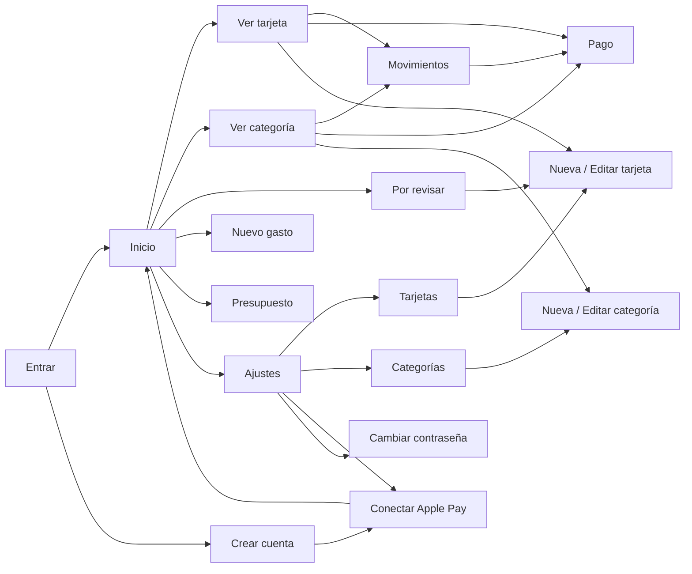

# Pantallas

Las 17 pantallas de Dipper. Cada una sigue la misma plantilla: para qué sirve, qué muestra, qué se
puede hacer, de dónde saca los datos y qué reglas tiene. Las piezas citadas están en
[`componentes.md`](componentes.md) y las reglas largas en [`flujos.md`](flujos.md).

Regla común: **ninguna pantalla tiene scroll** salvo Por revisar, Movimientos y la lista de
Presupuesto. Se comprueba a 402×778 (iPhone sin barras), midiendo también que nada se solape.

## Mapa

| Pantalla | Ruta PWA | Sesión | Tipo |
|---|---|---|---|
| [Entrar](#entrar) | `#/entrar` | No | Raíz |
| [Crear cuenta](#crear-cuenta) | `#/crear-cuenta` | No | Normal |
| [Inicio](#inicio) | `#/` | Sí | Raíz |
| [Ver tarjeta](#ver-tarjeta) | `#/ver-tarjeta?id=` | Sí | Normal |
| [Ver categoría](#ver-categoría) | `#/ver-categoria?id=` | Sí | Normal |
| [Movimientos](#movimientos) | `#/movimientos?tarjeta=&categoria=` | Sí | Normal, con scroll |
| [Pago](#pago) | `#/pago?id=` | Sí | Normal |
| [Por revisar](#por-revisar) | `#/por-revisar` | Sí | Normal, con scroll |
| [Nuevo gasto](#nuevo-gasto) | `#/nuevo-gasto` | Sí | Sube desde abajo |
| [Presupuesto](#presupuesto) | `#/presupuesto` | Sí | Normal |
| [Ajustes](#ajustes) | `#/ajustes` | Sí | Normal |
| [Tarjetas](#tarjetas) | `#/tarjetas` | Sí | Normal |
| [Categorías](#categorías) | `#/categorias` | Sí | Normal |
| [Nueva / Editar tarjeta](#nueva--editar-tarjeta) | `#/tarjeta?id=&wallet=` | Sí | Normal |
| [Nueva / Editar categoría](#nueva--editar-categoría) | `#/categoria?id=` | Sí | Normal |
| [Cambiar contraseña](#cambiar-contraseña) | `#/cambiar-contrasena` | Sí | Normal |
| [Conectar Apple Pay](#conectar-apple-pay) | `#/conectar-apple-pay` | Sí | Normal |

Sin sesión, cualquier ruta lleva a Entrar; con sesión, Entrar y Crear cuenta llevan al Inicio.
El mes que se está viendo en el Inicio se conserva al ir a Ver tarjeta, Ver categoría,
Movimientos y Presupuesto.

---

## Entrar

- **Para qué**: acceder a la cuenta.
- **Muestra**: "Dipper" 84/800 y "Tus gastos del mes, a la vista." sobre las olas de color; campo
  de correo y campo de contraseña con "Mostrar"; "Olvidé mi contraseña"; botón lima **Entrar**;
  si este iPhone tiene Face ID activado, separador "o" y botón oscuro **Entrar con Face ID**;
  "¿Primera vez? **Crear cuenta**".
- **Acciones**: Entrar (sin correo o contraseña: "Escribe tu correo y tu contraseña."); Face ID;
  Olvidé mi contraseña abre una hoja que explica cómo recuperarla (entrar con Face ID y cambiarla
  en Ajustes, o desde el ordenador), con botón de Face ID si está disponible.
- **API**: `POST /api/auth/login`, `POST /api/auth/passkey/login/options` y `/verify`.
- **Tras entrar con contraseña**: el Inicio ofrece activar Face ID una vez (ver Inicio).

## Crear cuenta

- **Para qué**: crear la cuenta (hoy solo la primera; ver [`auditoria.md`](auditoria.md)).
- **Muestra**: volver, bolitas, "Crea tu cuenta" 40/800, "Un minuto y listo."; campos nombre,
  correo y contraseña con **fuerza de contraseña**; casilla "Acepto los términos y la privacidad"
  (marcada); botón **Crear cuenta**; "¿Ya tienes cuenta? **Entrar**".
- **Reglas**: el botón se activa con nombre, correo válido, contraseña de 8 o más y la casilla.
- **API**: `POST /api/auth/register`. Al terminar va a **Conectar Apple Pay**.

## Inicio

- **Para qué**: ver el mes de un vistazo.
- **Barra**: ‹ mes › (el siguiente se desactiva al llegar al actual; "octubre" o "octubre 2025" si
  es de otro año) y a la derecha Presupuesto (`ICON` de reguladores) y Ajustes (engranaje, punteado).
- **Muestra, de arriba abajo**:
  1. "gastado en octubre" 15/600 `--muted`, total `min(92, 10,8 %)`/800 + "€", y
     "quedan 1.353 € de aire" o "te pasaste 120 €" (17/700).
  2. Barra de 20 segmentos (gastado ÷ presupuesto del mes).
  3. Abanico de tarjetas (ver *Tarjeta de pago*).
  4. Rejilla de categorías con líquido, que ocupa el alto que queda; cada una dice cuánto le queda
     ("Quedan 22 €") o "Sin margen".
  5. Abajo: recuadro punteado **"3 por revisar · Pagos nuevos sin categoría"** (o "Nada por
     revisar") con bolitas, y el botón + lima.
- **Acciones**: cambiar de mes; tocar tarjeta (despliega / abre Ver tarjeta); tocar categoría →
  Ver categoría; **mantener pulsada una categoría y arrastrarla** la cambia de sitio (cuadrícula
  ordenable) y ese orden se usa en toda la app; Por revisar; + → Nuevo gasto; Presupuesto; Ajustes.
- **Una sola vez tras entrar con contraseña**: hoja "¿Entrar con Face ID la próxima vez?" con
  **Activar** y **Ahora no** (no se vuelve a preguntar).
- **API**: `GET /api/month?month=AAAA-MM`.

## Ver tarjeta

- **Barra**: volver, "Tarjeta", lápiz → Editar tarjeta.
- **Muestra**: tarjeta grande (con pastilla "Apple Pay activo" si tiene nombre de Wallet);
  "con esta tarjeta en octubre", importe 64/800 y "32 % de lo gastado"; "Su parte de cada
  categoría" (recuadros de 112×96, solo las categorías con gasto); "Movimientos" en modo categoría,
  recortados para no hacer scroll, y "Ver todos los movimientos" → Movimientos de esa tarjeta.
- **Vacía**: "Todavía no hay pagos con esta tarjeta este mes."
- **API**: `GET /api/month`.

## Ver categoría

- **Barra**: volver, nombre de la categoría, lápiz → Editar categoría.
- **Muestra**: cabecera con líquido (icono, importe, "de 380 € este mes", pastilla "quedan X €" o
  "te pasas X €"); en el mes actual y con presupuesto, aviso punteado con reloj:
  "Te quedan 16 días. Para llegar a fin de mes, tocan unos **18,25 € al día**." (o "Último día del
  mes…", o "Te has pasado X € este mes."); "Por tarjeta" (pastillas con punto de color y
  "Visa · 64 €"); "Movimientos" en modo tarjeta, recortados, y "Ver todos los movimientos".
- **Vacía**: "Todavía no hay pagos en esta categoría este mes."
- **API**: `GET /api/month`.

## Movimientos

- **Barra**: volver, "Movimientos", pastilla del mes.
- **Muestra**: "Todos · 24 pagos" (o el nombre de la tarjeta o categoría filtrada) y el total;
  lista completa por días (modo tarjeta si se filtra por categoría; si no, modo categoría). Con scroll.
- **Vacía**: "No hay pagos este mes."
- **API**: `GET /api/month?tarjeta=` o `?categoria=` (lista y total ya filtrados).

## Pago

- **Barra**: volver, "Pago", papelera con confirmación (aviso "Toca otra vez la papelera para borrar
  este pago.").
- **Muestra**: caja con importe 52/800, nombre del comercio 22/800 con el lápiz, línea de Apple Pay
  y "hoy · 18:42 · Visa ···· 1234"; "Categoría" en rejilla de fichas; "Tarjeta" en fichas de
  tarjeta (la usada primero, más Efectivo); botón **Guardar** (activo solo si algo cambió).
- **Editar el nombre**: el editor de comercio sustituye al nombre, con la nota "Se cambia en todos
  los pagos de este comercio."; elegir un comercio propone su categoría; Guardar vale aunque no se
  pulse "Listo".
- **API**: `GET /api/charges/:id`, `POST /api/charges/:id` (`categoryId`, `cardId`, `merchant`),
  `POST /api/charges/:id/delete`.

## Por revisar

- **Barra**: volver, "Por revisar", contador de pendientes (pastilla oscura).
- **Muestra**: "Pagos de Apple Pay que llegaron solos. Confirma la categoría y Dipper la recordará
  para ese comercio." y una tarjeta por pago (con scroll):
  - Comercio con lápiz, línea de Apple Pay, punto de la tarjeta + "hoy · 12:30 · Tarjeta" e importe 26/800.
  - Si la tarjeta de Wallet no está guardada: recuadro punteado **"Tarjeta nueva · Guardarla en
    Dipper"** → Nueva tarjeta rellenada.
  - Si hay **varias tarjetas con ese nombre**: "Tienes varias tarjetas con este nombre. ¿Con cuál
    pagaste?" y sus fichas de tarjeta (sin Efectivo), con la adivinada marcada.
  - Franja `--surface-2` con "Sugerida: Súper" (o "¿En qué categoría va?") y la rejilla de
    categorías, la sugerida primero y punteada.
  - Interruptor **Recordar este comercio** (encendido) y botón **Confirmar** (activo con categoría
    y, si hace falta, tarjeta).
  - Al editar el nombre: "Nombre del comercio" + editor; se ocultan interruptor y Confirmar hasta "Listo".
- **Después de confirmar**: la tarjeta pasa a *tarjeta resuelta* con "Deshacer"; los demás pagos del
  mismo comercio se resuelven solos (sin Deshacer propio). Sin pendientes: **Todo al día**.
- **API**: `GET /api/pending`, `POST /api/pending/:id/confirm`, `POST /api/pending/:id/undo`.

## Nuevo gasto

- **Sube desde abajo**; se cierra con ✕.
- **Muestra**: importe grande; campo "¿Dónde? Mercadona, gasolina…" con icono de tienda;
  "Categoría" (fichas con icono, en fila deslizable); "Tarjeta" (fichas de tarjeta, la primera
  elegida, más Efectivo); "Fecha" (Hoy, Ayer, Otra fecha); teclado numérico; botón **Guardar gasto**
  (activo con importe > 0 y categoría).
- **Tras guardar**: pantalla de éxito sobre el fondo con un recuadro que se llena del color de la
  categoría y un check, "Pegado en Súper", "12,50 € · Visa · hoy", **Añadir otro** y **Volver al inicio**.
- **API**: `GET /api/month` (categorías y tarjetas), `POST /api/charges`.

## Presupuesto

- **Barra**: volver, "Presupuesto", pastilla del mes.
- **Muestra**: caja "Total del mes" con contador de 50 en 50 €, barra de 20 segmentos (asignado ÷
  total; en tomate si se pasa) y pastilla "350 € sin asignar" / "Todo asignado" / "Te pasas 40 € del
  total"; "Por categoría · de 10 en 10 €" con una fila por categoría (con scroll propio); nota "Los
  meses siguientes copian este reparto."; botón **Guardar presupuesto**.
- **Escribir un importe**: tocar el total o el importe de una categoría abre una hoja con el título
  (y el icono de la categoría), el importe grande "al mes" vacío, el teclado de Nuevo gasto sin
  decimales (máximo 6 cifras) y **Listo**. Lo escrito sustituye al importe; tocar fuera o Listo sin
  escribir no cambia nada. Se guarda, como siempre, con **Guardar presupuesto**.
- **Reglas**: el presupuesto vale para todos los meses; nada baja de 0.
- **API**: `GET /api/month`, `POST /api/budget`.

## Ajustes

- **Barra**: volver, "Ajustes".
- **Muestra**: caja de cuenta (bolitas, nombre y correo); filas **Tarjetas**, **Categorías**,
  **Conectar Apple Pay**, **Cambiar contraseña** y, si el iPhone lo admite, **Face ID** con pastilla
  Activar / Activado; abajo, botón blanco **Salir** con texto `--danger` y el enlace **Borrar cuenta**
  en `--danger`.
- **Borrar cuenta**: hoja "¿Borrar tu cuenta?" que explica que se borra todo para siempre, pide la
  contraseña (no si se entró con Face ID) y ofrece **Borrar mi cuenta** (botón blanco con texto
  `--danger`) y **Cancelar** (lima). Al terminar, vuelve a Entrar.
- **API**: `POST /api/auth/logout`, `POST /api/auth/delete-account`, registro de Face ID.

## Tarjetas

- **Barra**: volver, "Tarjetas".
- **Muestra**: una tarjeta por fila (96 de alto, radio 20, color de la tarjeta, nombre 17/800 y
  "···· 1234 · Nombre en Wallet"); recuadro punteado **+ Añadir tarjeta**.
- **Acciones**: tocar → Editar tarjeta; deslizar → Editar / Borrar.
- **API**: `GET /api/cards`, `POST /api/cards/:id/delete`.

## Categorías

- **Barra**: volver, "Categorías".
- **Muestra**: fila por categoría (icono en su color, nombre, `ICON.chevron`); **+ Añadir categoría**.
- **Acciones**: tocar → Editar categoría; deslizar → Editar / Borrar (sus pagos vuelven a Por revisar).
- **API**: `GET /api/categories`, `POST /api/categories/:id/delete`.

## Nueva / Editar tarjeta

- **Barra**: volver, "Nueva tarjeta" o "Editar tarjeta", papelera con confirmación al editar
  ("…Sus pagos se conservan.").
- **Muestra**: vista previa de la tarjeta en vivo; campos **Nombre** (máx. 22), **Últimos 4
  dígitos** ("Solo guardamos los 4 últimos. Nunca el número completo.") y **Nombre en Wallet**
  ("Así reconocemos la tarjeta cuando llega un pago de Apple Pay."); fichas "Llegaron en tus pagos"
  con los nombres de Wallet recibidos; selector de color; **Guardar tarjeta** (activo con nombre y 4 dígitos).
- **Desde Por revisar** llega con el nombre de Wallet y, si lo trae, los 4 dígitos ya puestos.
- **API**: `GET /api/cards`, `POST /api/cards` o `/api/cards/:id`, `POST /api/cards/:id/delete`.

## Nueva / Editar categoría

- **Barra**: volver, "Nueva categoría" o "Editar categoría", papelera con confirmación al editar
  ("…Sus 3 pagos volverán a Por revisar.").
- **Muestra**: vista previa con líquido; campo **Nombre** (máx. 24); selector de **Icono** (6) y de
  **Color** (6); **Guardar categoría**.
- **API**: `GET /api/categories`, `POST /api/categories` o `/api/categories/:id`, `POST /api/categories/:id/delete`.

## Cambiar contraseña

- **Barra**: volver, "Contraseña".
- **Muestra**: "Cambia tu contraseña" 34/800 y una explicación; campo de contraseña actual (solo si
  se entró con contraseña); contraseña nueva con fuerza; **Guardar contraseña**; al terminar
  "Contraseña cambiada." y vuelve a Ajustes.
- **Reglas**: con Face ID no pide la actual; cambiarla cierra las demás sesiones.
- **API**: `POST /api/auth/password`.

## Conectar Apple Pay

- **Barra**: indicador de pasos (dos segmentos llenos) y "Saltar".
- **Muestra**: "Que tus pagos lleguen solos", "Se configura una sola vez."; tres pasos numerados
  (copiar el enlace personal, crear la automatización en Atajos, añadir la acción); aviso "Solo
  llegan los pagos con Apple Pay. El efectivo y Bizum, a mano."; botón "Probar con un pago" / "Listo,
  ir al inicio".
- **Reglas**: los pasos marcados se recuerdan en el iPhone; "Abrir Atajos" abre la app Atajos.
- **API**: `GET /api/applepay`.
- **En la app nativa** esta pantalla cambia (ver [`flujos.md`](flujos.md#llegada-de-pagos-de-apple-pay)).
